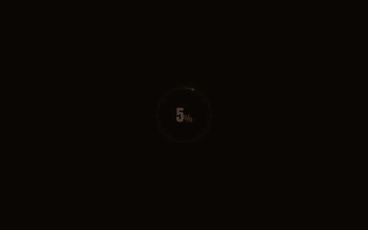
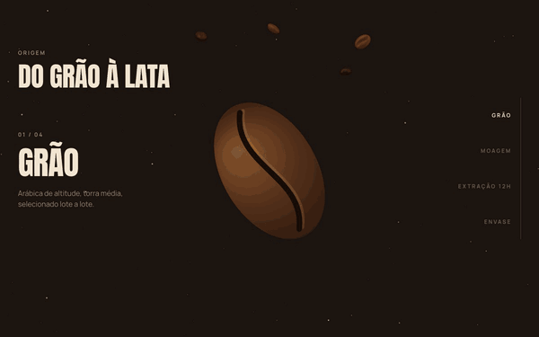
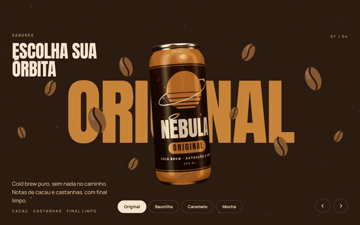
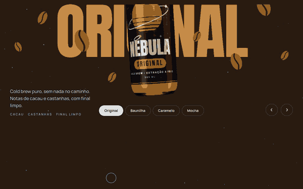

# Nébula — Café gelado de outra galáxia

Landing page de uma marca fictícia de cold brew em lata, feita para demonstrar animação guiada por scroll, 3D em tempo real, física interativa e microinterações no navegador, sem abrir mão de performance e acessibilidade.

> **Projeto fictício para portfólio.** A Nébula não existe: não há produto, checkout nem backend, e os depoimentos são inventados.



## Seções

| | |
|---|---|
| **Do grão à lata** — seção pinada por ~300vh. O scroll percorre quatro etapas: o grão racha, vira pó, o pó escorre em gotas enquanto um timer vai de 00:00 a 12:00, e a lata enche e fecha. |  |
| **Sabores** — trocar de sabor muda as cores da página inteira, gira a lata 360° trocando o rótulo no meio do giro e derruba os ingredientes do sabor ao redor. Funciona por tabs, setas do teclado, arrasto e swipe. |  |
| **Frio de verdade** — cubos de gelo com física caem ao entrar na tela e podem ser arrastados, arremessados e chacoalhados. |  |

Além dessas: hero com lata 3D e grãos em parallax, números com contadores e anéis que se desenham, marquee de depoimentos que acelera com o scroll, CTA final com botão de líquido e footer com o wordmark gigante.

## Stack

| Camada | Tecnologia |
|---|---|
| Base | Vite 8, React 19, TypeScript |
| Estilo | Tailwind CSS 4, com tokens de cor em CSS variables |
| Animação | GSAP + ScrollTrigger |
| Scroll suave | Lenis, dirigido pelo ticker do GSAP |
| 3D | Three.js via @react-three/fiber e @react-three/drei |
| Física | Matter.js |
| Fontes | Anton e Manrope, self-hosted via Fontsource |

## Técnicas

**Tudo procedural, sem assets externos**
- A lata é um `LatheGeometry` gerado a partir de um perfil 2D, com anel de abertura.
- Os quatro rótulos são pintados em canvas 2D (planeta listrado, wordmark, tabela de dados) e usados como textura.
- Os grãos são uma esfera deformada com sulco em S, desenhados com `InstancedMesh`.
- O reflexo metálico vem de um ambiente montado com `Lightformer`s, sem arquivo HDR.
- Gelo, grão, pó, gotas, estrelas e ingredientes são canvas 2D ou SVG inline.

**Um canvas WebGL para a página inteira**
- A lata não é posicionada em 3D: cada seção tem uma `div` âncora e a cena lê o `getBoundingClientRect()` dela a cada frame. Layout, responsividade e coreografia de scroll ficam em CSS e GSAP.
- A troca de rótulo é imperativa (`material.map`), sem re-render do React, e as texturas dos outros sabores são enviadas à GPU em segundo plano para a troca não travar.

**Scroll**
- Lenis roda no ticker do GSAP, então scroll suave e ScrollTrigger leem a mesma posição no mesmo frame.
- A seção pinada desenha em canvas como função pura do progresso do scroll, o que a torna reversível sem estado.
- As cores da página são interpoladas entre seções vizinhas conforme a fronteira cruza o meio da viewport.

**Interação**
- Texto dividido em caracteres com máscara, cursor com lerp, botões magnéticos e botão de líquido com filtro SVG "gooey".
- Arrasto dos cubos de gelo implementado sobre Pointer Events: tocar num cubo o agarra, tocar no vazio continua rolando a página.

## Performance e acessibilidade

Medido no build de produção servido localmente (`vite preview`), com Lighthouse 13.6 em Chrome headless, 3 execuções por modo:

| | Performance | Acessibilidade | Boas práticas | TBT | CLS |
|---|---|---|---|---|---|
| Mobile | 95–96 | 100 | 100 | ~240 ms | 0 |
| Desktop | 100 | 100 | 100 | 0 ms | 0 |

- 58–60 fps em todas as seções em Chrome headless num Mac com Apple Silicon, inclusive com CPU 4× mais lenta. **Não foi validado em celular físico.**
- A nota depende da carga da máquina no momento da medição.
- axe-core sem violações em todas as seções e nos quatro sabores; todos os temas passam em WCAG AA.

O que sustenta esses números:
- Three.js e Matter.js ficam em chunks separados; o Matter só é baixado quando a seção do gelo se aproxima.
- WebGL e física pausam fora da viewport (`IntersectionObserver`); `dpr` limitado a 2.
- Nenhuma animação de DOM mexe em layout: movimento é sempre `transform` e `opacity`; cores e traços SVG só repintam. As estrelas são bitmaps estáticos com twinkle em CSS, sem JavaScript por frame.
- Fontes com preload, para a primeira renderização não trocar de tipografia.

**`prefers-reduced-motion`** desliga o scroll suave, o pin, a física, o cursor e os botões magnéticos. A seção pinada vira um grid estático, o gelo é desenhado já assentado e o marquee vira uma lista.

## Decisões que fogem do briefing

- **Ambiente procedural em vez de `preset="city"`**: o preset do drei baixa um HDR de uma CDN em tempo de execução.
- **Anton no lugar de Clash Display/Syne**: o briefing pedia títulos condensados em caixa alta, e as fontes vêm do próprio bundle em vez do Google Fonts.
- **three fixado em 0.182**: a partir da r183 o `THREE.Clock`, que o react-three-fiber 9 ainda usa, gera um aviso no console a cada carregamento.
- **Estrelas em canvas 2D**, fora da cena 3D, para continuarem visíveis quando o WebGL está pausado.

## Rodando localmente

```bash
npm install
npm run dev      # servidor de desenvolvimento
npm run build    # checagem de tipos + build de produção em dist/
npm run preview  # serve o build de produção
npm run lint
```

## Estrutura

```
src/
  App.tsx
  styles/globals.css        tokens, fontes, keyframes
  lib/
    gsap.ts                 plugins + integração com o Lenis
    theme.ts                cores da página por seção e por sabor
    flavors.ts              dados dos quatro sabores
    canAnchors.ts           âncoras do DOM que a lata 3D segue
    sceneMotion.ts          valores animados pelo GSAP e lidos pela cena
    store.ts                estado global mínimo (sabor ativo, intro)
  components/
    Preloader, Navbar, Cursor, MagneticButton, LiquidButton,
    SplitText, Marquee, Stars, Logo
    three/                  Scene, Can, CanRig, LabelTexture, Beans
  sections/
    Hero, Process, Flavors, Ice, Stats, Testimonials, FinalCta, Footer
    process/                canvas de partículas, lata SVG, versão estática
    flavors/                ilustrações dos ingredientes
    ice/                    simulação com Matter.js
```

## Deploy

O projeto é um site estático e funciona na Vercel sem configuração: preset **Vite**, comando `npm run build`, saída em `dist`. A URL absoluta da imagem de preview social é montada no build a partir de `VERCEL_PROJECT_PRODUCTION_URL`.

## Créditos

Feito por [Lucas Santos](https://github.com/LucassSantoss). Fontes Anton e Manrope sob a SIL Open Font License.
